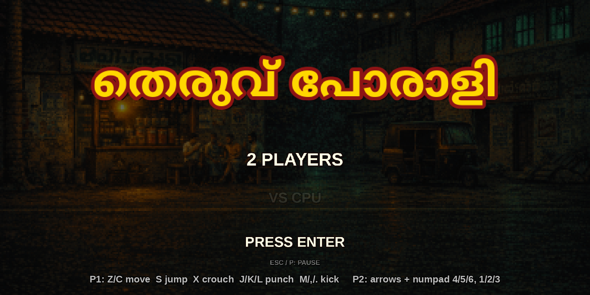
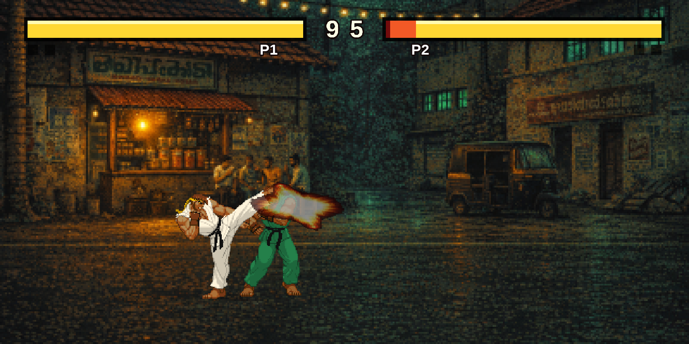
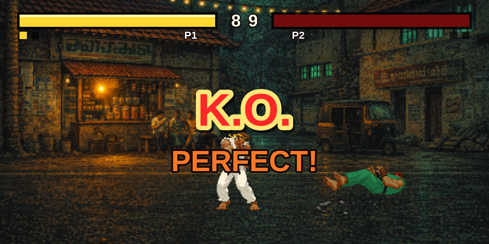
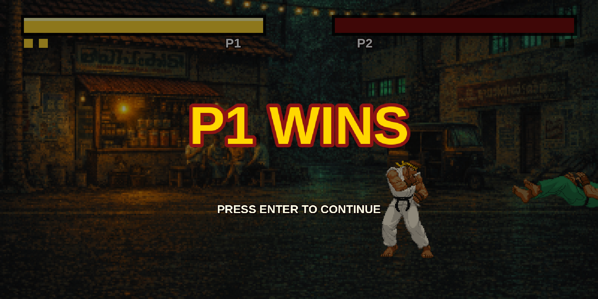
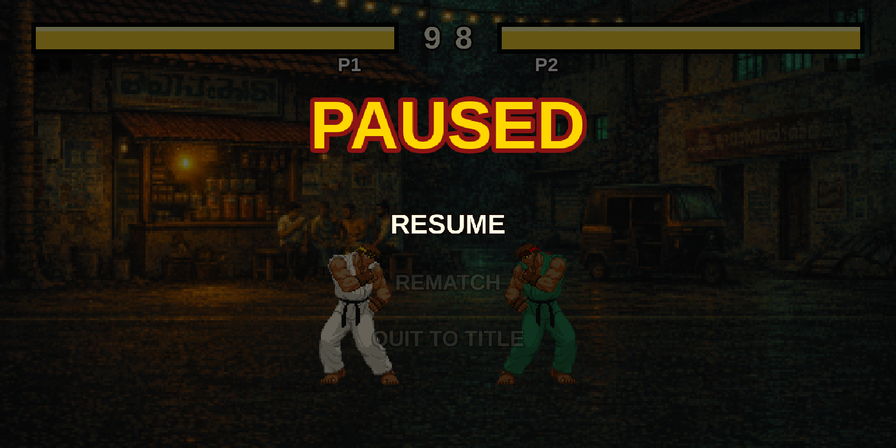

# തെരുവ് പോരാളി

A retro 2D street-fighting game set in a Kerala town — written in C++ with SDL2, playable natively or in the browser (WebAssembly).



## Features

- **Kerala street stage** — chaya kada, autorickshaw, palms and Malayalam signboards in 16-bit pixel art
- **Two fighter sets** — P1 in kasavu cream with gold trim, P2 in deep green, 143 animation frames each
- **Full match flow** — title / attract screen, ROUND 1 → FIGHT!, health bars with damage trail, 99-second round timer, best-of-3 rounds, K.O. / PERFECT! / TIME OVER callouts, winner screen
- **2 Players or VS CPU** — reactive CPU opponent that approaches, pokes, blocks and jumps
- **Pause menu** — Esc or P: Resume / Rematch / Quit to title
- **Sound** — hit, block, whiff, jump and fireball effects, round stingers and a chenda-melam style percussion loop
- Runs at 60 fps in the browser with the correct 2:1 aspect ratio






## Controls

| | Player 1 | Player 2 |
|---|---|---|
| Move | Z / C | ← / → |
| Jump | S | ↑ |
| Crouch | X | ↓ |
| Punches (light / medium / heavy) | J / K / L | Numpad 4 / 5 / 6 |
| Kicks (light / medium / heavy) | M / , / . | Numpad 1 / 2 / 3 |
| Start / confirm | Enter, Space or any attack button | |
| Pause | Esc or P | |

Hold back to block. Fireball: ↓ ↘ → + punch.

## Play in the browser

Requires the [Emscripten SDK](https://emscripten.org/) and a wasm build of yaml-cpp (see `preview-web.sh` for the expected prefix).

```bash
./preview-web.sh          # builds build-web/ and serves it on http://localhost:8000
```

Click the canvas once to give it keyboard focus (browsers also need that click before audio can start).

## Build natively (Linux)

```bash
sudo apt install cmake g++ libsdl2-dev libsdl2-image-dev libsdl2-mixer-dev libyaml-cpp-dev libglm-dev libglu1-mesa-dev
cmake -B build -DCMAKE_BUILD_TYPE=Release
cmake --build build -j"$(nproc)"
./openfight
```

## Asset tooling

All generated assets can be rebuilt from `tools/`:

- `tools/generate_sfx.py` — procedural sound effects and music loop (numpy, no samples)
- `tools/recolor_fighters.py` — builds the `data/p1` / `data/p2` fighter sets from the base sprites
- `tools/generate_background.py` — AI stage generation (needs `OPENAI_API_KEY`)

Debug hitboxes can be re-enabled with `CollisionBox::debug_draw = true`.
