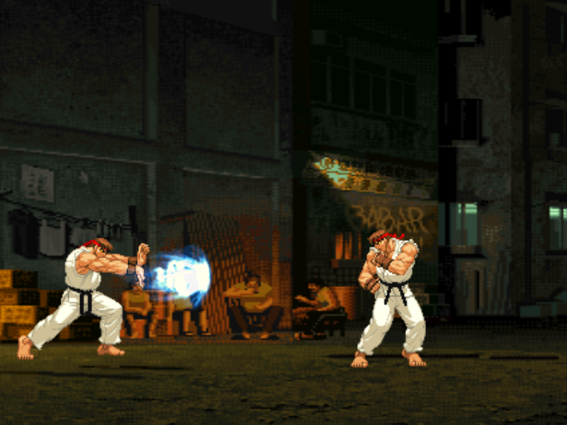
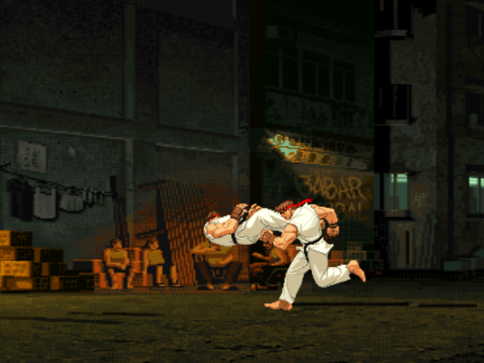
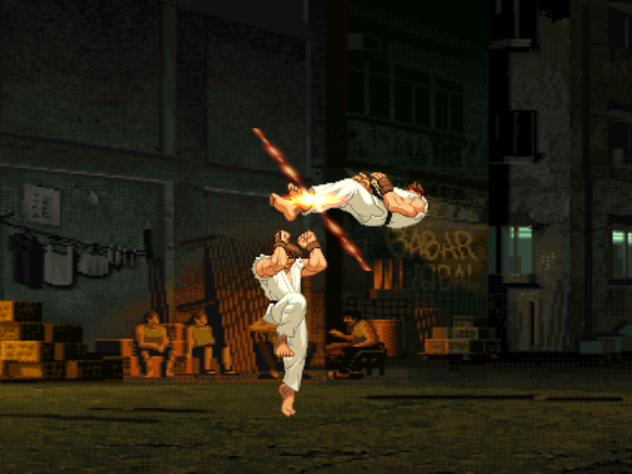
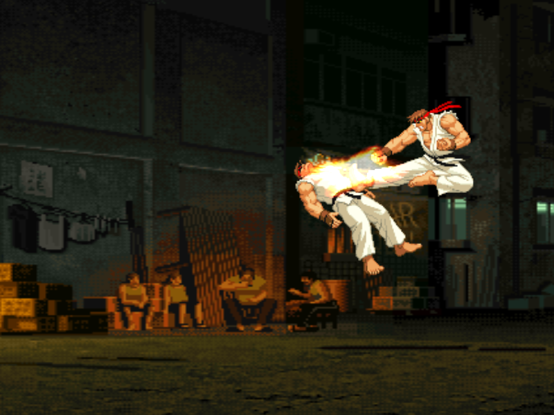

# തെരുവ് പോരാളി

This is an open source fighting game written in C++ using SDL

https://github.com/user-attachments/assets/1d26f60d-91d8-4dae-ac71-6a7d8bc14b7e

## Requirements

* cmake
* libyaml-cpp-dev
* libsdl2-dev libsdl2-image-dev libglu1-mesa-dev libglew-dev

The project can be executed using the following script:

    make ubuntu-install-deps build
    ./openfight

## 🤝 Contributing

Pull requests are welcome!  
If you find a bug or have a feature suggestion, feel free to [open an issue](https://github.com/slothrulez/openfight/issues).

## 🛣️ Roadmap

Check out the [ROADMAP](./ROADMAP.md) for planned features and upcoming improvements
